<div align="center">

# VEYRQUN

### Governance Layer for Financial AI Agents

**Per-agent permissions · real-time spend caps · instant revocation · fleet-wide emergency stop · a hash-chained audit log you can mathematically verify**

[](https://www.python.org/)
[](https://fastapi.tiangolo.com/)
[](https://react.dev/)
[](https://vitejs.dev/)
[](docs/Testing.md)
[](docs/Testing.md)
[](LICENSE)

*Started from [Aegis](https://github.com/infyier/aegis-governance) by **infyier** (American Express CodeStreet 2026, MIT).
v2 refactor and v3 gateway and platform work by **Gurjas Singh Gandhi**. See [CHANGELOG.md](CHANGELOG.md) for exactly what was inherited and what was added.*

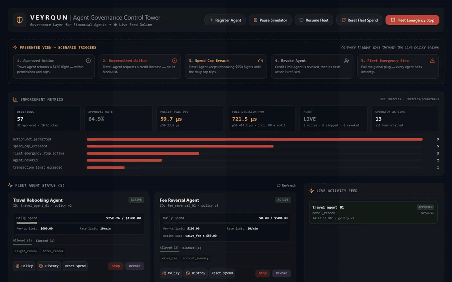

🎬 **Full screen recording (56 s):** [`app_screenshots_screen_recording/veyrqun_demo.mp4`](app_screenshots_screen_recording/veyrqun_demo.mp4)

</div>

---

## Table of contents

1. [The problem](#-the-problem)
2. [What VEYRQUN does](#-what-veyrqun-does)
3. [Problem-statement coverage](#-problem-statement-coverage)
4. [Architecture](#-architecture)
5. [Governance model](#-governance-model)
6. [Dashboard tour](#-dashboard-tour)
7. [Quick start](#-quick-start)
8. [API reference](#-api-reference)
9. [Testing, accuracy & latency](#-testing-accuracy--latency)
10. [Project structure](#-project-structure)
11. [Security, compliance & NIST RMF alignment](#-security-compliance--nist-rmf-alignment)
12. [Roadmap](#-roadmap)
13. [Documentation](#-documentation)
14. [License](#-license)

---

## 🎯 The problem

Banks are starting to deploy **fleets** of autonomous AI agents that rebook travel, reverse fees, raise credit
limits and issue cards. Each agent may be well designed. At fleet scale, though, the risk becomes systemic. One
prompt-injected agent, a runaway loop or a mis-scoped permission can move real money before any human notices.

What's missing is the **control plane**: a single place that decides what each agent may do, how much it may spend,
stops it instantly when needed, and keeps a record that regulators can trust.

## 🛡️ What VEYRQUN does

VEYRQUN acts as a **control tower, not the planes**. It sits inline between agents and execution back ends. Before
any agent action executes, VEYRQUN:

1. **Intercepts** it at a single policy enforcement point (`POST /simulate/action`).
2. **Evaluates** it against that agent's *live* policy: fleet stop, revocation, stop, deny-list, allow-list,
   per-transaction and per-action caps, rate limit, and daily spend cap. This takes about **1 µs**.
3. **Commits** the decision, the spend update and a **SHA-256 hash-chained audit entry** in one atomic transaction.
4. **Streams** the result and the agent's new state to the operator dashboard over WebSocket, with no polling.

Operators can rewrite any policy (versioned, with rollback), stop or revoke a single agent, or halt the entire fleet
with one click. Every one of those operator actions is also written into the same audit chain.

## ✅ Problem-statement coverage

| PS task | How VEYRQUN delivers it |
|---|---|
| **1. Permission model** that scopes each agent's actions with granular, configurable controls | Per-agent **allow-list** (default deny) + **deny-list** (explicit deny wins), **per-transaction limit**, **per-action caps** (e.g. `waive_fee ≤ $50`), **rate limit** per minute. Editable live from the dashboard or `PATCH /agents/{id}/policy`; every change creates an immutable **policy version** with a note, and any version can be **rolled back** |
| **2. Dynamic spend caps** enforced in real time across all agents | Daily cap checked on every action and committed **atomically** under a lock, so concurrent agents can never jointly overshoot (tested: 50 parallel $100 requests against a $1,500 cap → exactly 15 approved). Caps change instantly, with no restart |
| **3. Revocation + emergency stop** for one agent or the whole fleet | **Stop/Resume** (reversible pause), **Revoke/Reinstate** (credential kill that *survives* fleet resume), **Fleet Emergency Stop** (global flag + every agent halted; resuming one agent cannot bypass it) |
| **4. Operator dashboard** to configure policies, monitor activity and review audit logs | React control tower: agent tiles with spend meters and limits, live activity feed, policy editor, policy history and rollback, agent registration, enforcement metrics, filterable audit log with one-click **chain verification**, and 5 one-click demo scenarios |
| **5. Test & optimise** for enforcement accuracy, low latency and auditability | **45 automated tests** (every rule, boundaries, precedence, concurrency, tamper detection, WebSocket), a latency benchmark, live p50/p95/p99 metrics, and a profiling-driven optimisation that cut decision latency **~60×** |

## 🏗️ Architecture

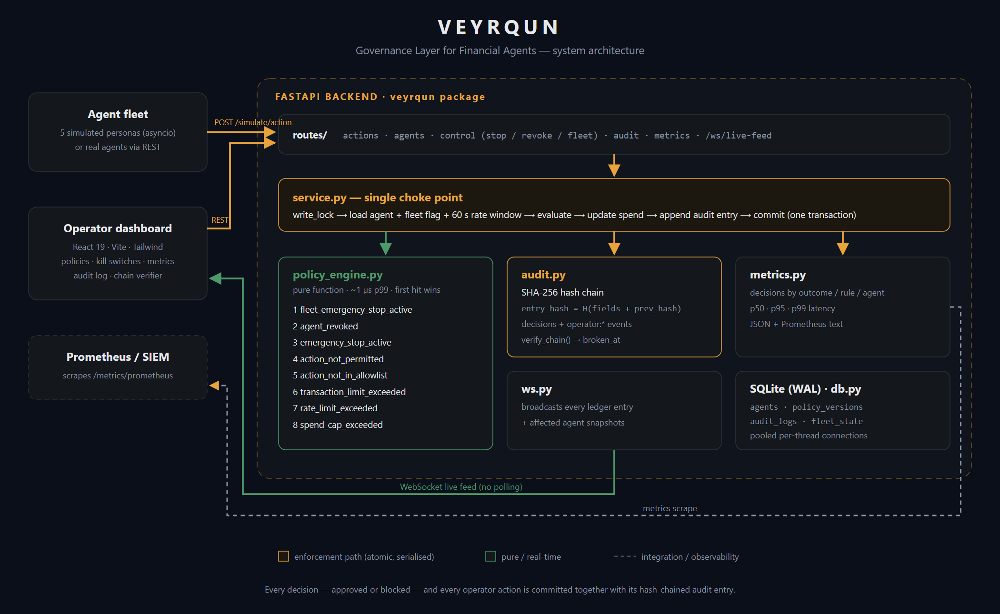

| Layer | Technology | Responsibility |
|---|---|---|
| Policy engine | Pure Python function | Deterministic, side-effect-free rule evaluation (~1 µs) |
| Service layer | Python, `threading.RLock` | The single choke point for every state change: evaluate → spend → audit → commit |
| Audit ledger | SHA-256 (`hashlib`) | Append-only parent→child hash chain, `verify_chain()` pinpoints tampering |
| API | FastAPI + Uvicorn | REST control plane, policy enforcement point, OpenAPI docs |
| Real-time | FastAPI WebSockets | Pushes every ledger entry + affected agent snapshots |
| Storage | SQLite (WAL) | `agents`, `policy_versions`, `audit_logs`, `fleet_state` (swap for PostgreSQL) |
| Observability | `/metrics`, `/metrics/prometheus` | Decision counts, blocks by rule, latency percentiles, fleet state |
| Dashboard | React 19, Vite 8, Tailwind v4, lucide-react | Operator control tower |
| Packaging | Docker Compose, nginx, Vercel config | One-command deployment |

### Decision flow

```text
agent ──► POST /simulate/action
            │
            ▼
   service.attempt_action ── acquire write_lock
            │  load agent · fleet flag · 60 s rate window
            ▼
   policy_engine.evaluate_policy  (pure, ~1 µs, first hit wins)
            │
            ├─ approved ─► spend += amount · record in rate window
            │
            ▼
   audit.append_entry (prev_hash → entry_hash)  ── same transaction
            │
   commit · release lock · record latency
            ▼
   WebSocket broadcast ──► dashboard (feed, spend meters, metrics)
```

## 🧭 Governance model

### Policy rules, in evaluation order (first match wins)

| # | Rule id | Blocks when… |
|---|---|---|
| 1 | `fleet_emergency_stop_active` | the fleet kill switch is engaged |
| 2 | `agent_revoked` | the agent's credentials have been revoked |
| 3 | `emergency_stop_active` | the agent has been individually stopped |
| 4 | `action_not_permitted` | the action is on the agent's **deny-list** |
| 5 | `action_not_in_allowlist` | the action is not on the **allow-list** (default deny) |
| 6 | `transaction_limit_exceeded` | amount > per-transaction limit, or > that action's specific cap |
| 7 | `rate_limit_exceeded` | approved actions in the last 60 s ≥ rate limit |
| 8 | `spend_cap_exceeded` | spend so far + amount > daily cap |

### Agent lifecycle

| State | Entered via | Left via | Survives "Resume Fleet"? |
|---|---|---|---|
| `active` | creation, resume, reinstate | stop, revoke, fleet stop | — |
| `stopped` | per-agent stop, fleet stop | resume, resume-all | No: resumes |
| `revoked` | revoke (with reason) | **reinstate only** | **Yes: stays revoked** |

### Seeded demo fleet

| Agent | Allowed | Denied | Daily cap | Per-tx | Rate | Action caps |
|---|---|---|---|---|---|---|
| Travel Rebooking (`travel_agent_01`) | flight_rebook, hotel_rebook | credit_limit_increase | $1,500 | $600 | 10/min | — |
| Fee Reversal (`fee_reversal_02`) | waive_fee, account_summary | wire_transfer | $500 | $100 | 10/min | waive_fee ≤ $50 |
| Credit Limit (`credit_limit_03`) | credit_limit_increase, score_check | card_issue | $5,000 | $2,500 | 6/min | — |
| Card Replacement (`card_replacement_04`) | card_issue, card_lock | waive_fee | $200 | $40 | 10/min | — |
| Account Inquiry (`balance_check_05`) | account_summary, balance_check | wire_transfer, flight_rebook | $100 | — | 4/min | — |

A background simulator drives these personas every 2–4 seconds, producing a realistic mix of approvals and
blocks across every rule type.

### Tamper-evident audit chain

```text
entry_hash = SHA-256( json.dumps({action_id, agent_id, action_type, amount, timestamp,
                                  outcome, rule_triggered, policy_version, prev_hash}, sort_keys=True) )
```

The first entry links to `GENESIS`. `GET /audit-log/verify` recomputes every hash and link and returns either
`{"valid": true, "entries_checked": N, "head_hash": …}` or the exact `broken_at` entry. The tests prove it detects
**edited**, **deleted** and **re-hashed forged** rows. Operator actions (`operator:policy_update`, `operator:revoke`,
`operator:fleet_emergency_stop`, …) are chained too, so the log answers both *what did the agent do?* and
*who changed the rules, and when?*

## 🖥️ Dashboard tour

All screenshots and the screen recording are in [`app_screenshots_screen_recording/`](app_screenshots_screen_recording/).

### Control tower overview
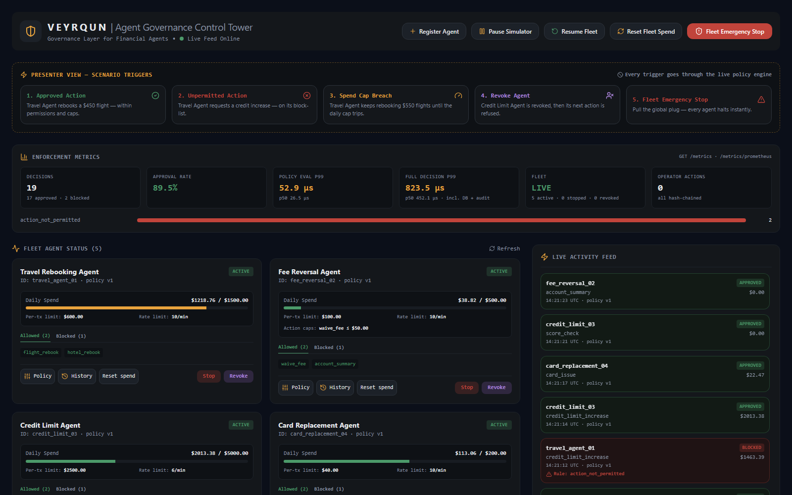
*Fleet controls, one-click demo scenarios, live enforcement metrics (decisions, approval rate, policy-eval and full-decision p99 latency, fleet status), agent tiles and the streaming activity feed.*

### Agent fleet: permissions, caps and limits at a glance
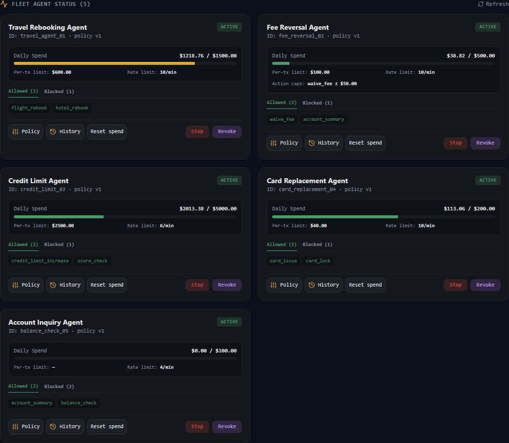

### Policy editor: granular, versioned controls
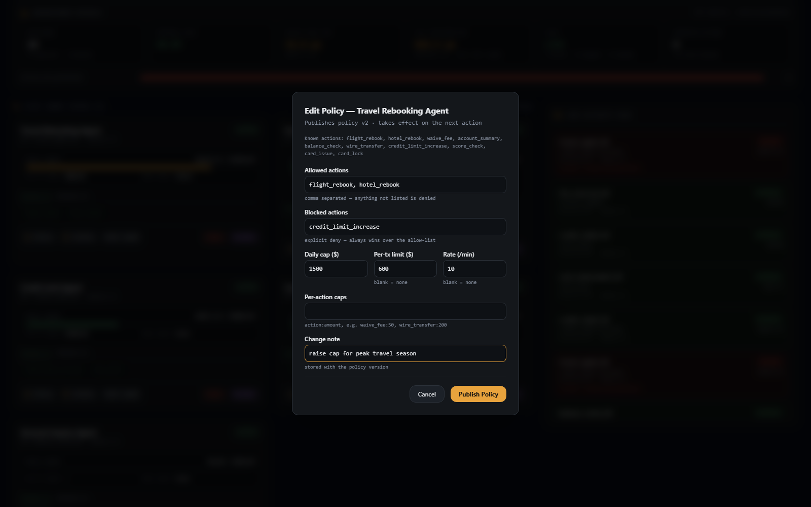
*Allow/deny lists, daily cap, per-transaction limit, rate limit, per-action caps and a change note. Publishing creates policy v(n+1), which applies to the very next action.*

### Blocked in milliseconds, with a reason
| Unpermitted action | Spend-cap breach |
|---|---|
| 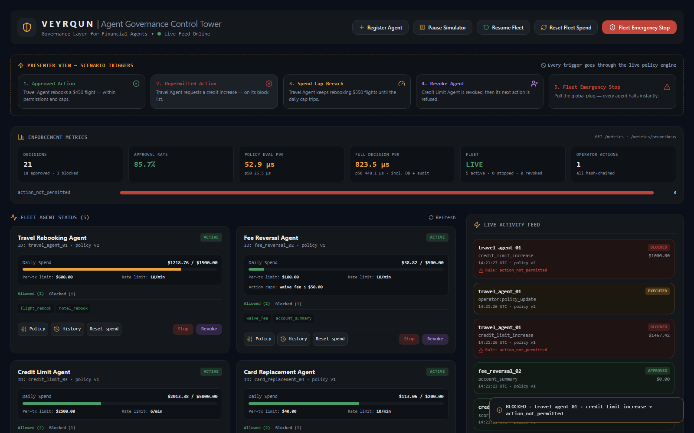 | 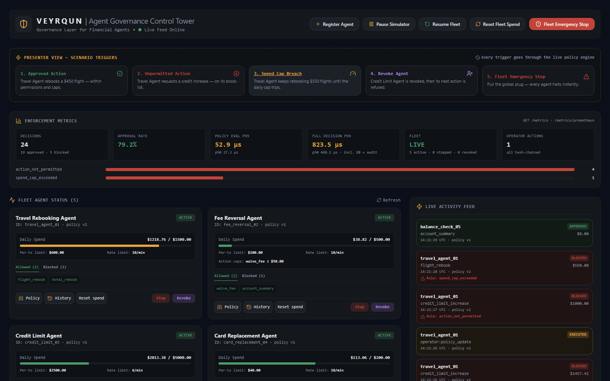 |

### Revocation
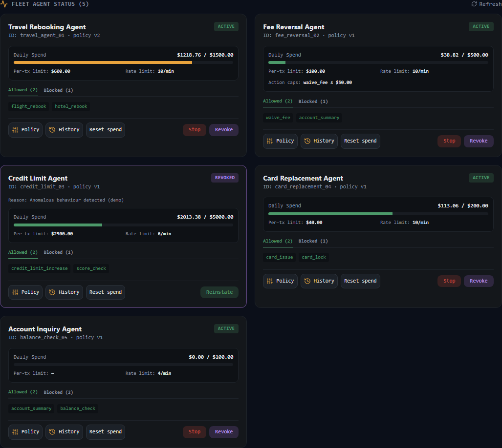
*A revoked agent turns violet, shows its revocation reason, and has every action refused with `agent_revoked`. Fleet resume does not reinstate it.*

### Fleet emergency stop
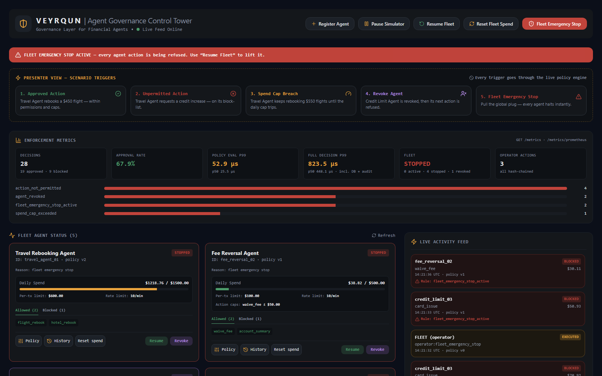
*One click: a global banner appears, every tile flips to STOPPED, and the feed fills with `fleet_emergency_stop_active`.*

### Enforcement metrics
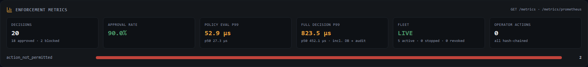

### Policy history and forward-only rollback
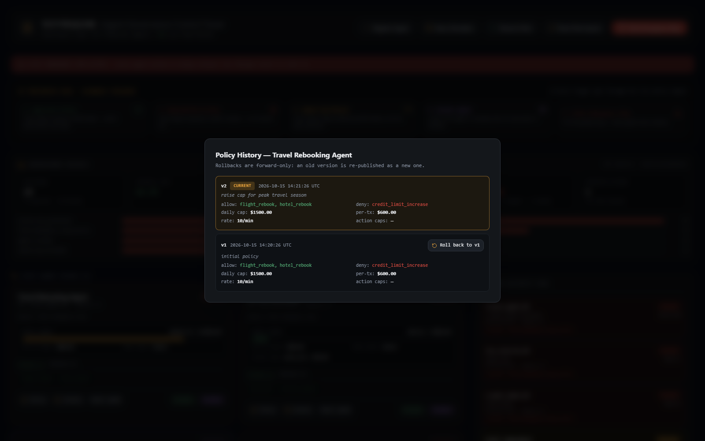

### Hash-chained audit log, verified
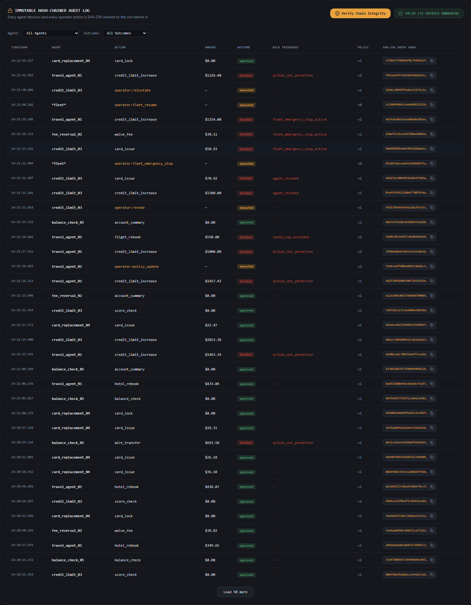
*Every decision **and** every operator action, each stamped with its policy version and SHA-256 hash. **Verify Chain Integrity** walks the full chain.*

| Register an agent | OpenAPI docs | Prometheus metrics |
|---|---|---|
| 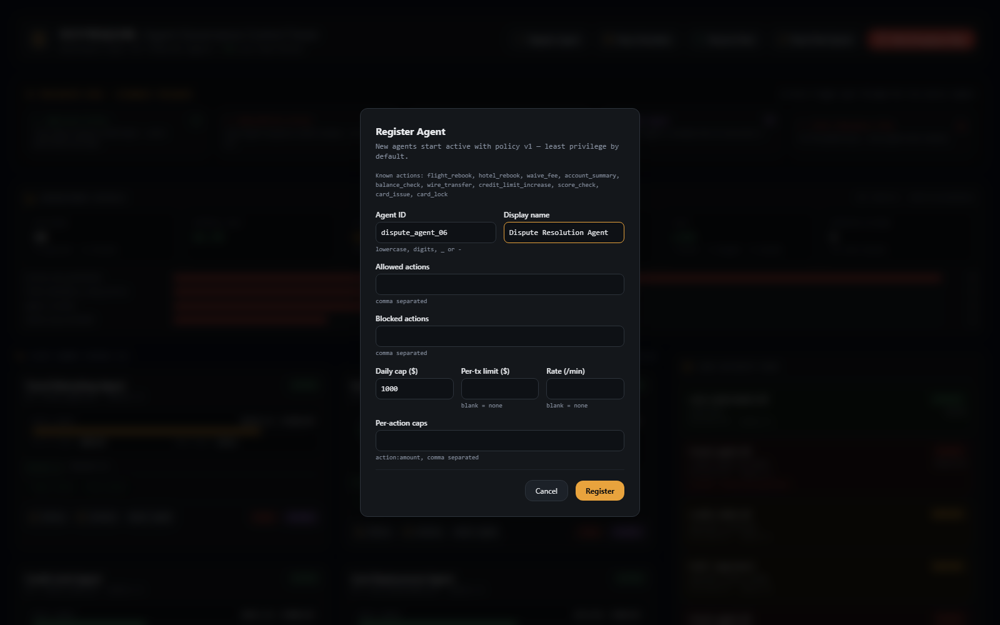 | 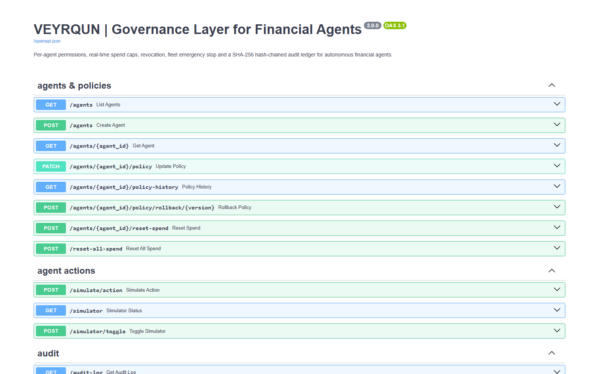 | 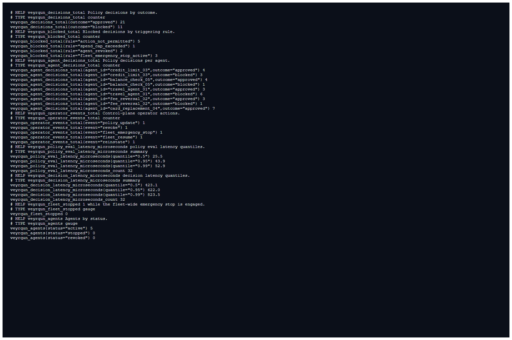 |

A full-page capture is also available: [`00_full_dashboard.png`](app_screenshots_screen_recording/00_full_dashboard.png).

## 🚀 Quick start

**Prerequisites:** Python 3.11+, Node.js 20+ (Vite 8 requirement).

### Option A: Docker (one command)

```bash
docker compose up --build
```

| Service | URL |
|---|---|
| Dashboard | http://localhost:5173 |
| API | http://localhost:8000 |
| OpenAPI docs | http://localhost:8000/docs |

The SQLite database is persisted in the `veyrqun-data` volume.

### Option B: local, one command

```bash
pip install -r requirements.txt
npm install && npm --prefix frontend install
npm start            # or ./start.sh — runs backend + frontend together
```

### Option C: local, two terminals

```bash
# terminal 1 — API
pip install -r requirements.txt
python -m uvicorn --app-dir control-plane app:app --host 0.0.0.0 --port 8000

# terminal 2 — dashboard
cd frontend && npm install && npm run dev
```

### Try it from the command line

```bash
# approved
curl -s -X POST localhost:8000/simulate/action -H 'Content-Type: application/json' \
     -d '{"agent_id":"travel_agent_01","action_type":"flight_rebook","amount":450}'

# blocked: action_not_permitted
curl -s -X POST localhost:8000/simulate/action -H 'Content-Type: application/json' \
     -d '{"agent_id":"travel_agent_01","action_type":"credit_limit_increase","amount":1000}'

# tighten a policy live (creates v2), then roll back to v1
curl -s -X PATCH localhost:8000/agents/fee_reversal_02/policy -H 'Content-Type: application/json' \
     -d '{"spend_cap_daily":250,"note":"incident #142"}'
curl -s -X POST localhost:8000/agents/fee_reversal_02/policy/rollback/1

# revoke one agent, halt the fleet, resume
curl -s -X POST localhost:8000/agents/credit_limit_03/revoke -H 'Content-Type: application/json' -d '{"reason":"suspected compromise"}'
curl -s -X POST localhost:8000/emergency-stop
curl -s -X POST localhost:8000/resume-all

# prove nothing was altered
curl -s localhost:8000/audit-log/verify
```

### Configuration

| Variable | Default | Purpose |
|---|---|---|
| `VEYRQUN_DB_FILE` | `control-plane/veyrqun.db` | SQLite database path |
| `VEYRQUN_SIMULATOR` | `1` | Set `0` to disable the background agent simulator |
| `ALLOWED_ORIGINS` | `*` | Comma-separated CORS origins |
| `VITE_API_BASE_URL` | `http://localhost:8000` | Dashboard → API URL (build time) |

Cloud deployment (Vercel + Render/Railway) is covered in [docs/Deployment.md](docs/Deployment.md).

## 📡 API reference

| Area | Method & path | Purpose |
|---|---|---|
| **Enforcement** | `POST /simulate/action` | Evaluate an agent action → approved/blocked + audit entry |
| Agents | `GET /agents` · `GET /agents/{id}` | Live status, spend, limits, policy version |
| | `POST /agents` | Register an agent |
| Policies | `PATCH /agents/{id}/policy` | Partial update → new version (`null` clears a limit) |
| | `GET /agents/{id}/policy-history` | Version timeline |
| | `POST /agents/{id}/policy/rollback/{v}` | Forward-only rollback |
| Spend | `POST /agents/{id}/reset-spend` · `POST /reset-all-spend` | Reset daily spend |
| **Revocation** | `POST /agents/{id}/revoke` · `POST /agents/{id}/reinstate` | Credential kill / restore |
| **Emergency stop** | `POST /emergency-stop/{id}` · `POST /resume/{id}` | Single agent |
| | `POST /emergency-stop` · `POST /resume-all` · `GET /fleet/status` | Whole fleet |
| **Audit** | `GET /audit-log?agent_id=&outcome=&action_type=&limit=&offset=` | Filterable ledger |
| | `GET /audit-log/verify` | Full chain verification |
| Observability | `GET /metrics` · `GET /metrics/prometheus` · `GET /health` | JSON / Prometheus / liveness |
| Simulator | `GET /simulator` · `POST /simulator/toggle?running=` | Background traffic control |
| Real-time | `WS /ws/live-feed` | Every ledger entry + agent snapshots |

Full request/response examples: [docs/API Reference.md](docs/API%20Reference.md). Interactive docs: `/docs`.

## 🧪 Testing, accuracy & latency

```bash
pip install -r requirements-dev.txt
python -m pytest                 # 45 tests
python control-plane/benchmark.py      # latency table
```

| Dimension | What is verified |
|---|---|
| **Enforcement accuracy** | Every rule fires correctly; exact boundaries (cap reached exactly passes, +$0.01 blocks); float drift cannot cause false blocks; full rule precedence; evaluation is pure |
| **Real-time caps under concurrency** | 50 parallel requests never overshoot the cap; the hash chain stays valid |
| **Policy lifecycle** | Updates take effect on the next action; version stamping; history; rollback; explicit-null clears |
| **Kill switches** | Single-agent stop/resume; fleet stop blocks every agent; single resume cannot bypass fleet stop; revocation survives fleet resume |
| **Auditability** | Every decision and operator action is logged; edited, deleted and re-hashed-forgery rows are all detected with the exact `broken_at` |
| **Latency budgets** | Policy eval p99 < 50 µs (10k runs); full decision p95 < 5 ms (300 runs) |
| **Interfaces** | Input validation (422/404/409), audit filters, metrics JSON + Prometheus, WebSocket streaming |

### Benchmark: Windows 11 laptop, Python 3.12

```text
policy engine (pure evaluation)          20000  p50      0.70 µs  p95      0.90 µs  p99      1.00 µs
full decision (eval + DB + audit)         2000  p50     97.70 µs  p95    157.00 µs  p99    653.50 µs
audit chain verify                        2001  total 15.6 ms  valid=True
```

**Optimisation:** profiling showed that opening a SQLite connection (~1.1 ms) cost more than the entire decision.
Switching to pooled per-thread connections, with WAL and `synchronous=NORMAL`, cut full-decision p50 from
**5.9 ms to 98 µs (~60×)**. Governance therefore adds well under a millisecond to an agent's action. Details are in
[docs/Testing.md](docs/Testing.md).

## 📁 Project structure

```text
VEYRQUN/
├── control-plane/
│   ├── app.py                    # entry shim (uvicorn app:app / backend.app:app)
│   ├── benchmark.py              # latency benchmark
│   ├── Dockerfile
│   ├── requirements.txt
│   ├── veyrqun/
│   │   ├── main.py               # FastAPI app, lifespan, error handling
│   │   ├── config.py             # environment configuration
│   │   ├── db.py                 # schema, migrations, seed fleet, pooled connections, write lock
│   │   ├── models.py             # request validation
│   │   ├── policy_engine.py      # pure rule evaluation
│   │   ├── service.py            # atomic decisions + operator actions
│   │   ├── audit.py              # SHA-256 hash-chained ledger + verifier
│   │   ├── metrics.py            # counters, latency percentiles, Prometheus export
│   │   ├── simulator.py          # background agent traffic
│   │   ├── ws.py                 # WebSocket fan-out
│   │   └── routes/               # agents · actions · control · audit · metrics
│   └── tests/                    # 45 pytest tests
├── frontend/
│   ├── src/
│   │   ├── App.jsx               # state + operator handlers
│   │   ├── api.js · policyFormat.js · styles.js
│   │   ├── hooks/useLiveFeed.js  # auto-reconnecting WebSocket
│   │   └── components/           # Header, ScenarioPanel, MetricsPanel, AgentCard, LiveFeed,
│   │                             # AuditLog, PolicyEditorModal, PolicyHistoryModal, CreateAgentModal, ui
│   ├── Dockerfile · vercel.json · vite.config.js
│   └── package.json
├── app_screenshots_screen_recording/   # 14 screenshots + demo recording (mp4 + gif preview)
├── docs/                         # architecture, backend, frontend, API, data models, testing, deployment, demo script
├── docs_images/                  # architecture diagram
├── docker-compose.yml
├── package.json · start.sh       # one-command local start
├── requirements.txt · requirements-dev.txt · pytest.ini
└── LICENSE
```

## 🔒 Security, compliance & NIST RMF alignment

| NIST RMF step | How VEYRQUN supports it |
|---|---|
| **Categorize** | Each agent is a distinct governed identity with an explicit action scope |
| **Select** | Least-privilege controls: default-deny allow-list, explicit deny, monetary and rate limits |
| **Implement** | Controls are enforced inline at a single enforcement point, before execution |
| **Assess** | 45 automated tests assert control effectiveness; `/audit-log/verify` provides an integrity check on demand |
| **Authorize** | Policy versions carry change notes; every authorisation change is an audited `operator:*` event |
| **Monitor** | Live dashboard, WebSocket feed, `/metrics` + Prometheus export, per-rule block counters |

Other properties:

- **Fail-closed by design:** anything not explicitly allowed is denied, and the deny-list always wins.
- **Atomicity:** a decision, its spend update and its audit entry commit together or not at all.
- **Separation of pause vs. kill:** stop is reversible, while revocation requires an explicit reinstate.
- **Tamper-evidence:** this supports internal-control evidence needs (e.g. SOX-style change and activity logs, PCI-DSS-style transaction limits). It does not by itself certify compliance.

> **Scope note:** this is a hackathon prototype. The control plane has no authentication yet, and the hash chain
> is tamper-*evident*, not tamper-*proof*. See [Technical Debt](docs/Technical%20Debt.md) for the production hardening list.

## 🗺️ Roadmap

- **AuthN/Z:** OIDC for operators (operator vs. auditor roles), mTLS or signed tokens for agents, and operator identity recorded in the hash chain
- **Policy-as-code:** compile the same ordered rules to **OPA** or **Cedar**
- **Scale-out:** PostgreSQL with per-agent row locks, Redis rate windows and pub/sub, horizontal API replicas
- **Observability:** Grafana dashboards on `/metrics/prometheus`, Splunk forwarding of the audit stream
- **Stronger audit guarantees:** WORM storage plus periodic external notarisation of the chain head hash
- **Smarter limits:** time-of-day windows, per-counterparty caps, anomaly-triggered automatic stops

## 📚 Documentation

| Doc | Contents |
|---|---|
| [Home](docs/Home.md) | Index and PS coverage |
| [Architecture](docs/Architecture.md) | Components, flows, state model, concurrency, scaling path |
| [Backend](docs/Backend.md) | Package layout and design choices |
| [Frontend](docs/Frontend.md) | Components, real-time model, operator workflows |
| [API Reference](docs/API%20Reference.md) | Every endpoint with examples |
| [Data Models](docs/Data%20Models.md) | Tables and rule identifiers |
| [Testing](docs/Testing.md) | Test matrix, benchmark, optimisation log |
| [Deployment](docs/Deployment.md) | Local, Docker, cloud, environment variables |
| [Demo Script](docs/Demo%20Script.md) | 5-minute judge walkthrough |
| [Technical Debt](docs/Technical%20Debt.md) | What was fixed in v2 and what's next |

## 📜 License

Distributed under the MIT License. See [LICENSE](LICENSE).
