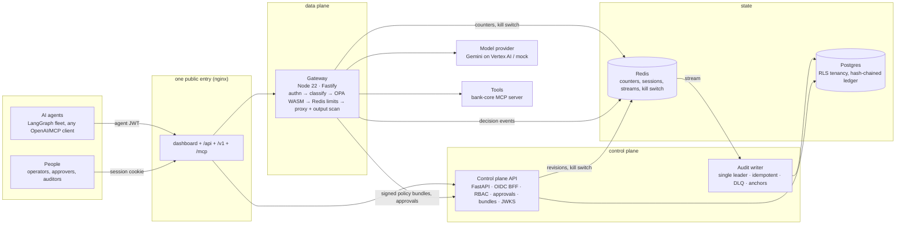

# Architecture

## Components

## One governed request

1. **Authenticate.** The agent presents a short-lived Ed25519 JWT from `POST /api/oauth/token`. The gateway checks
   it against the control plane's JWKS.
2. **Load policy.** The gateway holds the workspace's signed bundle (compiled Rego as WASM, plus agent data) in
   memory. A stale bundle beyond `BUNDLE_MAX_STALENESS_S` fails closed.
3. **Classify.** Detectors run on canonical text (NFKC, invisible characters removed, look-alikes mapped) over decoded
   argument values. They find cards (Luhn), Aadhaar (Verhoeff), IBAN (mod 97), PAN, email, phone and secrets, and
   compute an injection signal.
4. **Decide.** OPA evaluates in-process (about 0.1 ms) and returns allow, block, redact or require_approval with a
   `rule_id`. No model takes part in this step.
5. **Limit.** One atomic Redis Lua script covers rate limit, daily spend cap and per-action cap. If Redis is
   unreachable, the request is refused, except for configured read-only actions.
6. **Hold.** `require_approval` returns 202 with an approval id. A person decides, and the agent retries with
   `x-veyrqun-approval`. The approval is bound to that agent, action and amount, and works once.
7. **Proxy.** Masked classes are redacted in prompts and in tool arguments. Responses are scanned too, including
   streamed responses (a hold-back buffer catches data split across chunks) and tool calls the model emits.
8. **Record.** A decision event goes onto a Redis stream. The audit writer appends it to the ledger:
   - The chain is SHA-256 linked, and each entry also carries an HMAC.
   - Writes are idempotent on `decision_id`.
   - Ed25519-signed head anchors are created periodically.

## Failure behaviour

| Failure | Behaviour |
|---|---|
| Unknown agent, tool or model | blocked (default deny) |
| Policy bundle stale | 503, fail closed |
| Redis down | 503, except configured read-only actions |
| Model upstream down | failover to the next upstream (model calls only), else 502/504 |
| Tool upstream timeout | 504; never retried; spend reservation kept for reconciliation |
| Audit writer behind | async mode: serve and alert; strict mode: 503 |
| Kill switch | every request refused within about 300 ms (`docs/results/kill_switch.json`) |
| Model budget exhausted | 429 `llm_budget_exhausted` |

Each row has an integration test in `gateway/test/contract.test.ts`.

## Tenancy and identity
- People sign in through an OIDC provider (Keycloak in compose) via a backend-for-frontend. The browser only holds an
  HttpOnly session cookie plus a CSRF token.
- There are six roles, with MFA for privileged ones, step-up for kill switch and key rotation, maker-checker for
  policy publishes, and separation of duties.
- Every tenant table has Postgres row-level security keyed by `app.workspace_id`. The audit chain is global; its head
  is read through a `SECURITY DEFINER` function that returns only a hash.

Decisions and trade-offs: [docs/adr/](adr/).
